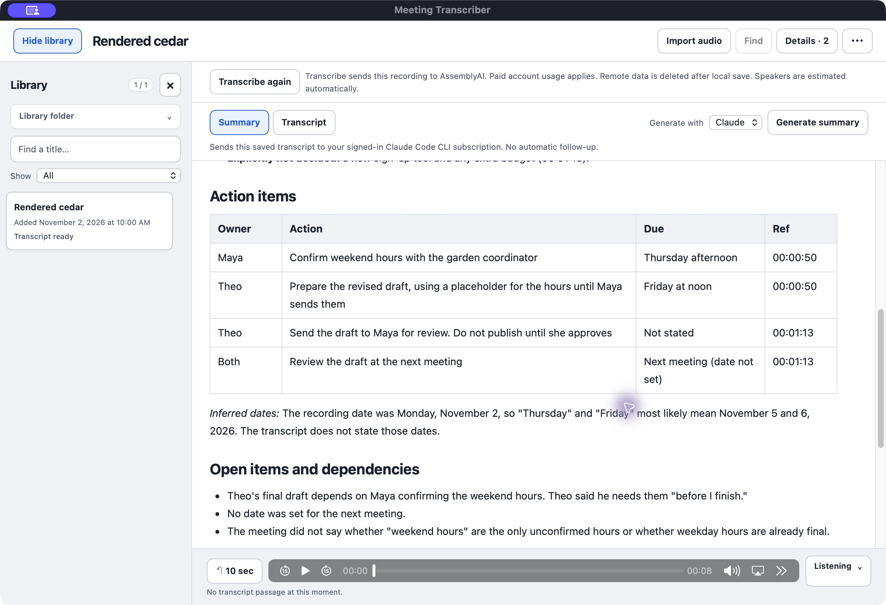
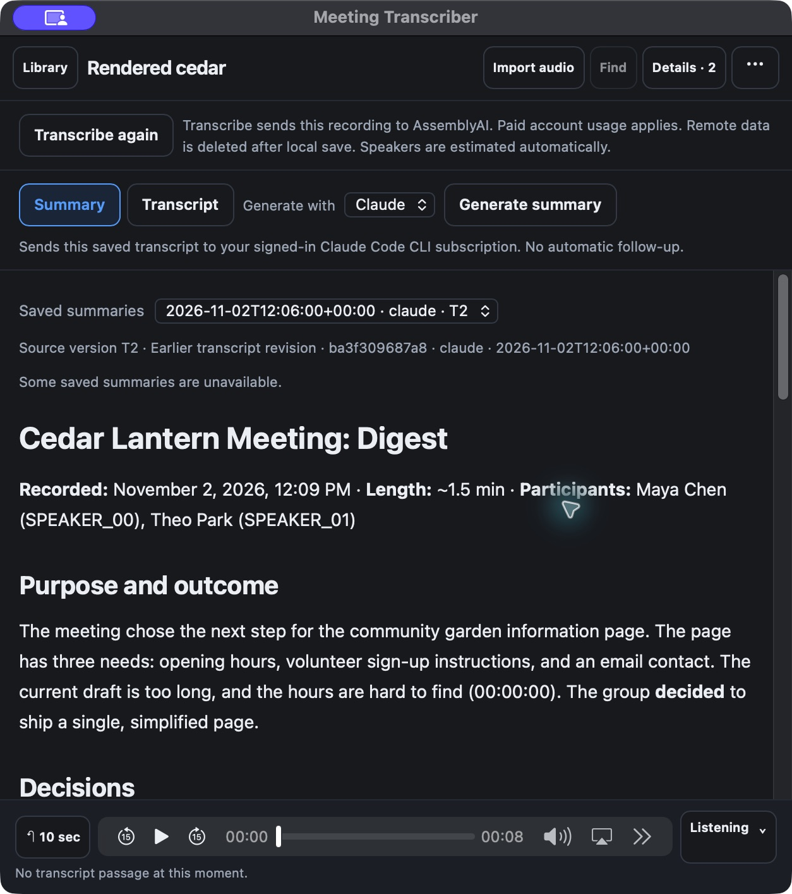
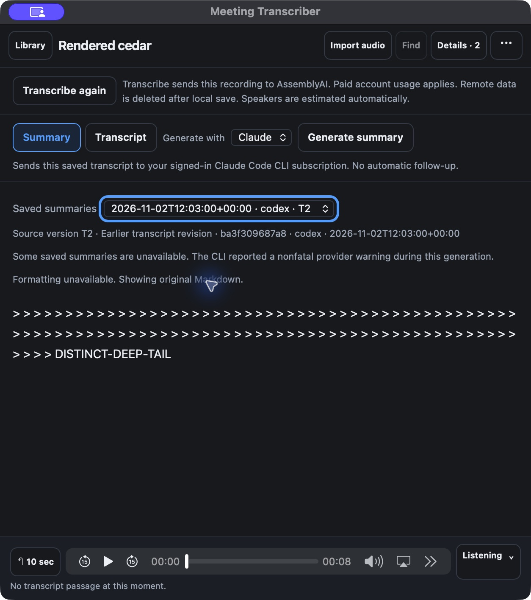
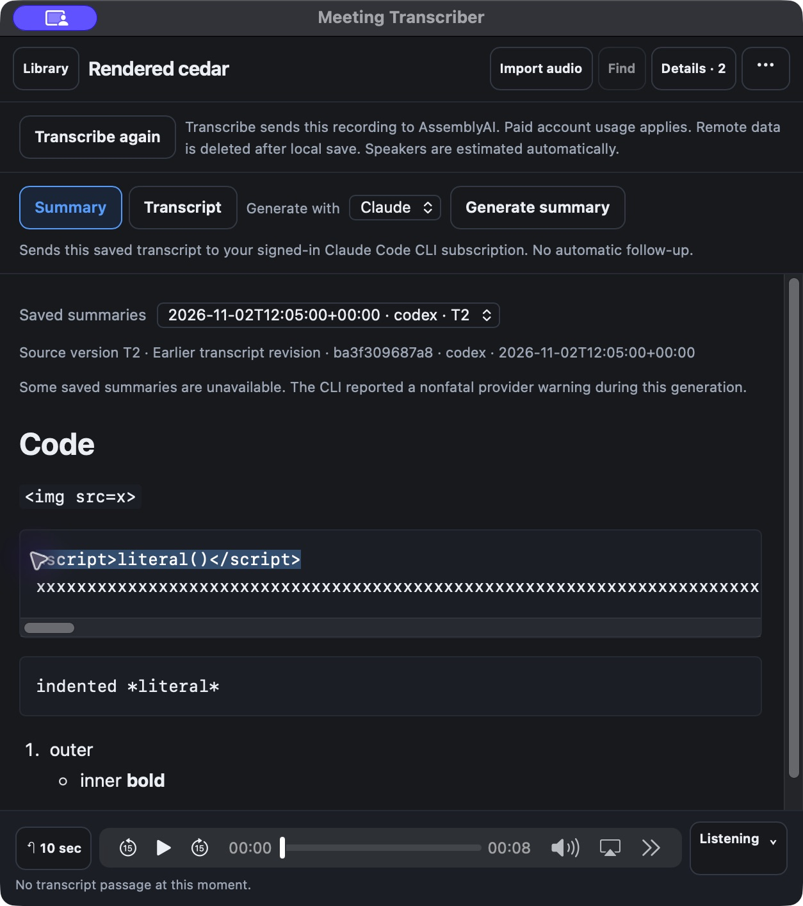
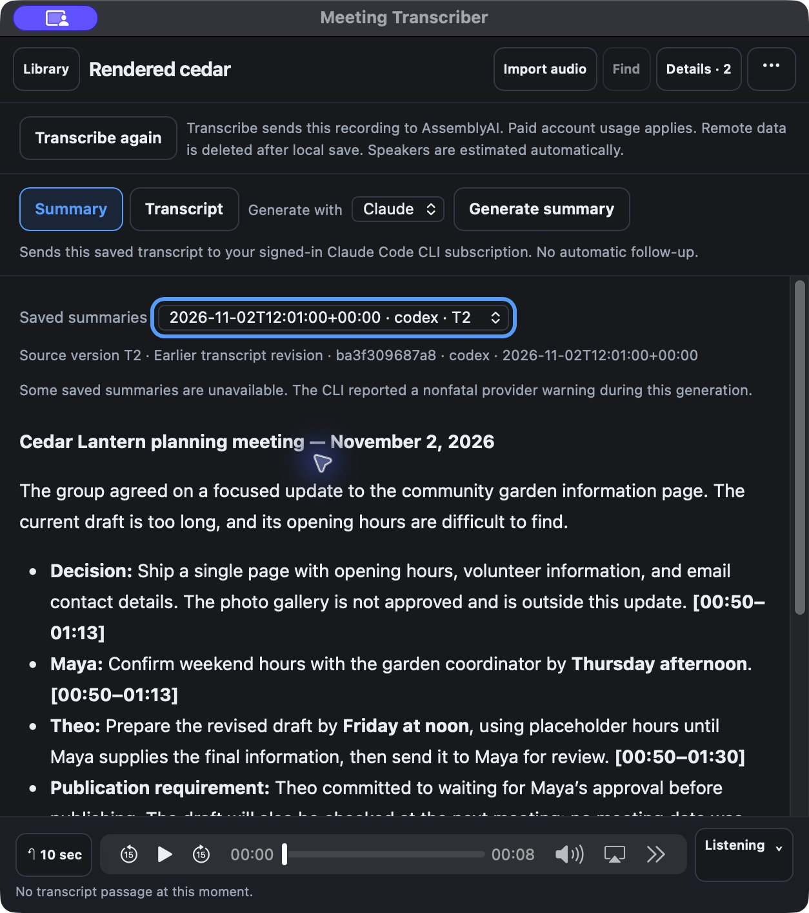

# Rendered summaries: Mac package observations

The relocated arm64/WKWebView package passed the selected native compatibility
checks on macOS 26.5.2 at source
`2dda750389550e553cecd68bd59ec49fa9f37196`. Both source gates and the
[Windows package/browser proof](../../windows-2026-11-02/rendered-summaries/README.md)
were already approved. The same source outer reviewer approved the Mac
evidence-only continuation at `f7d733c9d3e04118ed21caa9a7e72d57e66c598c`,
test quality PASS and no findings. It inspected the actual report, results and
captures, verified unchanged product source and artifact bindings, and accepted
the observed scope and limits below. It did not execute Mac or independently
rehash its remote app/library. This report does not claim landing or release.

## Package and isolation

The existing frozen Python 3.13.15, pywebview 6.2.1 and PyInstaller 6.22.3
environment built the exact source with `python -m desktop.build`. The app was
copied outside its checkout and its frozen executable launched twice with an
owned synthetic home, configuration, library and temporary directory, no inherited
AssemblyAI key and no Python on PATH. Its live executable/PID, selected environment,
listener and synthetic library were verified before each UI attachment.

All six packaged reader assets matched source, including the approved parser
SHA-256 `391f2aa638e75e6c7859d0a5c5650ef0956722a45998f17e05b83bc655778e1e`
and combined notice SHA-256
`0b2ece9c2df0b3ae40b46d17811bc57caca9c1803200b1dc8cd2cde214dc06c9`.
The executable SHA-256 is
`c03c63bd3ae9c5f9d0477ffd536c25e3b5c1c4fea133d0d835f3ed4d3069600f`.
[Results and relative manifests](results.json) bind 45 regular, non-symlink
package files and 17 original synthetic library files. These counts do not
describe every symlink in a macOS app bundle.

## Observed behavior

- Both saved fictional summaries rendered with readable structure. At 1200
  logical pixels in light mode, Claude's four-row action table and time references
  remained readable.
  At 627 pixels in dark mode, headings, provenance, history, saved warnings,
  earlier-revision labels and reader/player controls remained readable.
- Inline, fenced and indented code remained literal. Nested lists rendered;
  long code scrolled locally. Drag selection returned the literal
  `` text and invoked no generated action.
- The original 1540-byte sparse table took the plaintext fallback. Because the
  native observation tool caps each AX text-node label at 512 characters, one
  additional production-published 393-byte sparse fixture crossed the same
  admission bound (4288 estimated cells). Its complete normalized source and
  distinct tail were observed natively. The complete deep fixture and its final
  tail also survived, with separate formatting and saved/provider notices.
- The accepted 131,067-byte single-word fixture loaded/formatted in a selected
  1019 ms UI observation. Native UI Select All exposed the **entire original
  string**, including `NEAR-LIMIT-TAIL`. Scrolling did not visually locate that
  tail; this report claims native selected-text fidelity rather than a tail
  screenshot. Deep selection was observed at 1075 ms. These are bounded
  observations, not universal parser-performance claims.
- Returning to ordinary content cleared only the formatting notice. Holding
  aside a known synthetic history target after its option loaded produced the
  existing unavailable-history notice while preserving the readable code body.
  Restoring the original files and Refresh cleared the transient error and
  retained the saved warning. T2 → T1 → T2 replaced the body and provenance.
- Summary → Transcript navigation returned in a selected 1194 ms observation.
  Timestamp selection highlighted the first passage; the native Play control
  advanced the silent fixture to its eight-second end. Returning to Summary
  restored the rich content. A full app restart rediscovered the same table,
  history, warning and earlier-revision label.
- Both normal closes removed the owned app process, closed the selected reader
  listener and removed the private session. All 17 original library files and
  all 45 regular package files retained their initial hashes. The added compact
  fixture remains outside the original library as evidence; nothing was deleted.

## Observation limits and first attempts

Some native popup actions did not select the requested entry; failed selections
are not rendering timings. Temporary same-byte isolation of task-owned synthetic
records, followed by the existing Refresh action, made code and near-limit
observations deterministic. All originals were restored before final comparison.
An initial fixture setup reused expired Library identities; a fresh scan supplied
the production-owned identities before publication, without a product change.

The existing intermittent Mac AX subtree omission occurred in the transcript and
player. Visual inspection established those states. Rapid timestamp autoplay
followed immediately by a native toggle interrupted the first play promise and
showed the existing playback notice; the separate native Play action reached
eight seconds, and Refresh cleared the transient notice. No audio or provider
code was changed. Shutdown observations cover the owned app process, its selected
ports and private sessions, not every unrelated macOS WebKit process.

The Windows browser tests own the full hostile-content/request, parser-fault,
pre-parser admission and exact DOM-source matrix. They were not replayed on Mac.
No provider/model call, real-library scan, dependency/source/global-setting change,
installer/signing/notarization or sustained-memory qualification occurred here.

## Unmodified native captures

These actual package captures contain only the synthetic meeting. Original bytes
are preserved; the `.jpg` extensions match the tool's JPEG format. Metadata
inspection found ordinary image dimensions/density and the display color profile,
with no private paths or authentication material. Images were not reencoded.

Wide/light action table with readable owner, due date and reference columns:

Narrow/dark rich summary, saved warning and earlier-revision provenance:

Deep fallback retains its tail and separates formatting from existing warnings:

Literal code, local horizontal scrolling, nested lists and actual text selection:

Existing fictional Codex summary retains its persisted nonfatal warning:

