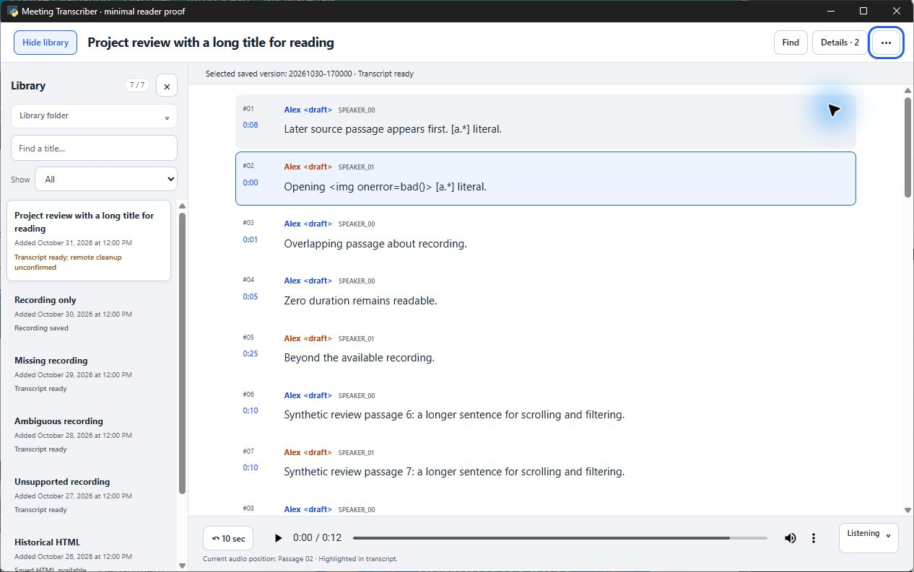

# Windows evidence preservation — 1 November 2026

This archive preserves unique work from the previous Windows machine. It does
not resume implementation or QA and does not qualify later Mac changes on
Windows. TranscribeMacOS is the active project lead and owns the current
continuation document and planning index.

## Source is already on GitHub

The preservation audit fetched origin and found no local production commit
unreachable from the remote refs. All four original Windows worktrees were clean.

| Remote branch at the audit | Exact source commit |
| --- | --- |
| `codex/desktop-library-viewer` | `cea92c4d30abba215e021d49ae1d2108c1a9eb12` |
| `codex/meeting-digests` | `8c718b2fd2cad08e8154587ad0cfdf7fc656bb0a` |
| `codex/desktop-import-transcription` | `c390b35a931bac8bfc4e5f0db73e66e1a0e3dccb` |

Branches may advance; the commits above identify the snapshots. The Windows
`codex/meeting-digests` branch was only an unused checkout at `cea92c4`; it
contains no separate digest implementation. Do not push that stale local ref
over the Mac's remote branch. This archive uses a separate preservation branch
based on `cea92c4` and changes no application source, dependencies or PR.

## What Windows actually verified

The final Windows reader qualification applies to `cea92c4`, based on the
earlier desktop delivery at `1b3a64b6c483babdab8f2c33b8daff57c18cd527`.
The original fresh Sol/xhigh inner reviewer approved the source, correction
delta and Windows native evidence. Mac GUI evidence was explicitly outside
that Windows verdict.

- Focused Python desktop checks: 27 tests, 25 passed and 2 skipped. The skips
  were the Mac environment check and the opt-in native WebView2 probe. The
  tested Python owners, tests and environment remained unchanged during the
  final static-asset corrections, so that evidence was reused.
- Separate `node --check desktop/assets/app.js` and `git diff --check` calls
  exited 0 for both final corrections. The initial commit's checks were one
  combined batch; their individual exit codes were not separately printed.
- Actual WebView2 interaction covered wide/light and narrow/dark composition,
  library collapse, title/category intersections, empty results, Find wrapping,
  speaker filtering with duplicate names, retained chips and individual clears,
  saved-version context, refresh retention, Escape and keyboard focus.
- Actual native audio covered no autoplay, passage playback, speed, Follow,
  manual-scroll release, Jump, Back 10 and playback with Library and Listening
  collapsed. Missing, ambiguous and unsupported recordings retained readable
  text. Saved HTML opened through the real production export owner in the
  system browser; only the synthetic export tab was closed afterward.
- The paused footer now uses neutral current-position wording. A narrow search
  followed by a return to a remembered collapsed wide Library restores visible
  focus to the Library opener.
- The final library error proof used a fresh app before opening media/exports:
  an atomic rename made the real synthetic root unavailable; Refresh returned
  0/0 and an error; collapsing Library retained visible feedback and an Open
  Library recovery action. Atomic restoration, Open Library and Refresh
  recovered all 7 meetings and cleared the error. Normal native close exited
  0 and the fixture hashes were unchanged.

The folder-picker cancel/choose tests used a synthetic picker dependency;
they establish bridge/UI wiring, not a new native folder-dialog qualification.
Explicit fresh overlap/beyond-duration checks were not repeated for this
presentation delta; unchanged prior reader evidence was retained. No real
recording, microphone, AssemblyAI job or digest model was used in this Windows
reader pass.

### Inspected native captures

All four captures contain synthetic data and are unretouched original bytes.
Their archived extensions are `.jpg`, matching their actual JPEG encoding;
the original local filenames incorrectly used `.png`.

1266 × 793, Windows WebView2, `cea92c4`. The selected non-default saved version
remains identified with Details closed; text is escaped and the native player
is paused at the beginning.

- [Narrow dark reader](captures/reader-narrow-dark-cea92c4.jpg), 518 × 793.
- [Live playback with Library and Listening collapsed](captures/playback-collapsed-cea92c4.jpg).
- [Real library error with Library hidden](captures/library-error-hidden-cea92c4.jpg).

The successful recovery capture is intentionally excluded because its folder
panel displays a personal machine path. Its observed 7/7 recovery is recorded
above and in the sanitized evidence record.

## Archived records and proof source

- [Author check output, with machine paths replaced](records/author-checks.txt.txt).
- [Full historical reader record, with machine paths replaced](records/review-record.md.txt).
- [Final synthetic native launcher source](scripts/launch_native.py.txt).
- Earlier source snapshots in `scripts/`: `proof.py.txt`, `ui-proof.py.txt`,
  `integrated-smoke.py.txt`, `pending-close-proof.py.txt`,
  `verify-interruption.py.txt`, `close_controlled_probe.py.txt` and
  `build-study.py.txt`.
- `source-snapshots/` retains six historical HTML artifact sources: the initial
  exploration, desktop plan, original viewer spec, GUI proposal, minimal layout
  study and approved reader-organization spec. They are text archives, not live
  pages. Embedded links refer to the original artifact layout.

These `.txt` files are preservation evidence, not installed tests or current
operating instructions. Some older proofs used superseded automation and fixed
workspace layouts. They have not been adapted to or run against the later digest
or import implementation. Review them before any reuse; follow the current
checkout's instructions and supported UI tools. The final launcher generated
task-owned synthetic bundles and used the real Library, Bridge, ReaderServer
and native session owners. It did not call a transcription provider.

Historical records contain intermediate failures and superseded pause states.
The final Windows reader result is the approval described above. A failed
recursive fixture move was diagnosed as a test-setup problem, its synthetic
files were restored, and the final successful error proof used atomic rename
instead. That failed attempt is not counted as a passing error-recovery check.

## Dependency facts and limits for the next Windows machine

The recorded reader environment used Windows x64, CPython 3.13.12, pywebview
6.2.1, Bottle 0.13.4, PyInstaller 6.22.3 and the installed WebView2 runtime.
Python was constrained to `>=3.13,<3.14`. Node was used for JavaScript syntax
checking; its version was not recorded. These are historical facts, not a new
dependency recommendation. Use the latest checkout's manifest, lockfile and
development documentation to prepare the next machine.

The previous personal package was unsigned and not a clean-machine release
qualification. Its reproducible binaries, virtual environments and generated
synthetic audio are not in this archive. No credential files or CLI auth caches
are needed or copied; sign in independently on the new machine when required.

No Windows digest or desktop import/transcription QA occurred after `cea92c4`.
Those later changes require Windows qualification at their actual tested tip,
including private writes/ACLs, native bridge actions and close behavior,
packaging, provider CLI readiness, digest persistence and installed FFprobe
setup. Mac qualification does not establish those Windows results. The Mac
lead's current source, specs and continuation document own the exact checklist.

A disposable Python 3.13 Windows proof did establish private directory/file
creation, fsync/atomic replacement and reload with actual owner/DACL inspection.
It was a mechanism observation only, not qualification of the later product's
private-file writer. The historical POSIX `os.fchmod` writer was not assumed to
work unchanged on Windows.

## Product decisions handed to the Mac lead

AssemblyAI remains the transcription provider. This is a personal Windows/Mac
desktop app for mostly in-person room meetings. Libraries stay local and whole
meeting folders are copied between machines when needed.

The user selected explicit summary generation through either signed-in Codex
or Claude, no automatic generation, retained successful summary history with
the newest shown first, source transcript-version identification, and Summary
first when available. `skills/meeting/SKILL.md` is the repository skill owner.
The Mac's later implementation and reviewed contracts supersede preliminary
Windows suggestions about storage or CLI controls.

No production source or pending fix remains unique to this Windows host.
Machine-only leftovers are disposable/generated data, build outputs,
environments, excluded screenshots/raw local logs, and private workflow/auth
state. Continuing the project must not depend on those leftovers.
