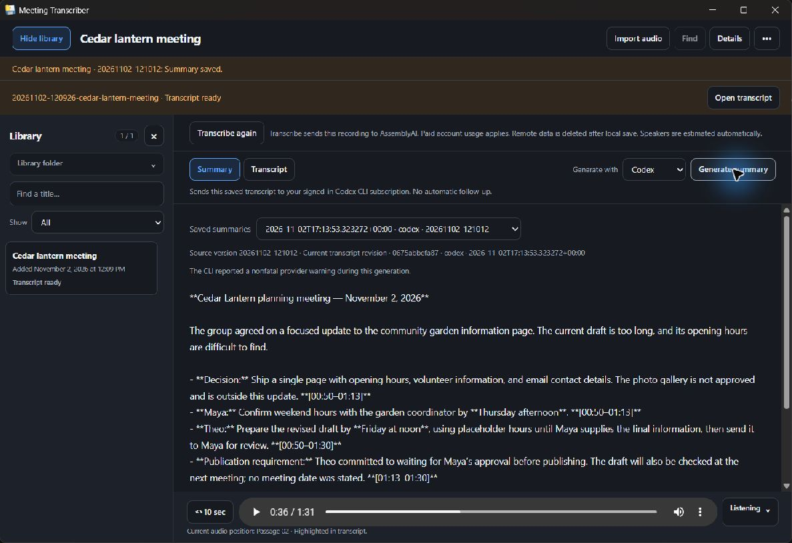
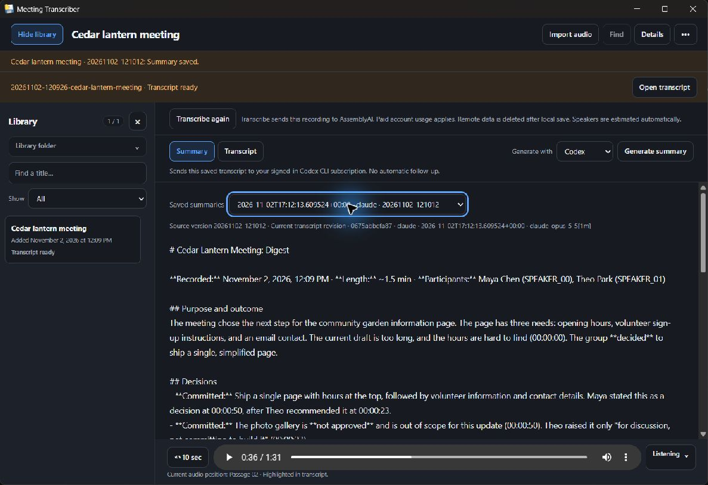

# Windows live end-to-end smoke

**PASS with one retained Codex nonfatal provider warning.** On November 2, 2026, the operator-approved 91.297415-second fictional recording completed one native AssemblyAI transcription and one subscription summary through each installed Codex and Claude CLI. No product change or rebuild was needed. These are author-observed live results; the Mac lead owns reconciliation. They do not add a full-release claim.

## Exact candidate and calls

Integration base `f91f866c856e6a4db41aa6591662d8709a841241`; unchanged product `2640f2903f4b9e4ebda97697410798bdfaf514a7`. Reused the relocated Windows 11 x64 package: exe SHA-256 `d5100f870006597c9698a4f92b50fb7b8054a8e7eb71d20cde13a2eba18191db`, original 102-file manifest SHA-256 `686b95151906c2b8165efbb99444b84907f77aef64590cabb321bb8998271918`. All package hashes remain unchanged. [Prior package/build/manifest evidence](https://github.com/ccolosimo3/meeting-transcriber/blob/3c0e4e0654c6d40930b4d0f1a97e7fe9d403d77f/docs/handoffs/windows-2026-11-02/win-qual-3-corrected/README.md), [production CLI controls](https://github.com/ccolosimo3/meeting-transcriber/blob/2640f2903f4b9e4ebda97697410798bdfaf514a7/desktop/digest_job.py), [provider owner](https://github.com/ccolosimo3/meeting-transcriber/blob/2640f2903f4b9e4ebda97697410798bdfaf514a7/lib/transcribe_assemblyai.py).

Input SHA-256 `f817f03f07c2a8beb90aa8498068a05651f7caf0d86f70da731b0e2d1638462d`, 4,026,262 bytes. Installed offline Windows voices produced fictional Maya Chen and Theo Park; no personal recording or microphone. Source and imported bytes/duration were rechecked immediately before the single Transcribe action. The ordinary request used `universal-3-5-pro`, diarization, punctuation, formatting and language detection, with no forced speaker count.

One upload and one submission follow from the single completed app lifecycle and unchanged adapter owners, which do not retry those POSTs; no independent wire capture was added. Normal polling and deletion completed, with zero manual cleanup retries or retranscriptions. Generation counts are **Claude 1, Codex 1** through the actual app; no regeneration. CLI internal network attempts were not observed. Independent preflight command counts and ordinary per-generation metadata checks are distinguished in [results](results.json).

The AssemblyAI cap was $0.10. The lead-supplied input-duration estimate is approximately **$0.00584**; actual billing was not queried and is unknown. This was a procedural cap, not a provider-enforced budget. Both summaries used existing subscriptions, with no API-key model route or plan/account change.

## Results and practical inspection

- Native setup accepted the operator's key saved through the existing private store using hidden terminal input. Real subscription/control readiness passed for both native executables; Codex MCP suppression passed. Ordinary auth locations were retained while data/config/output were pinned to a fresh private test tree before first scan. No personal library was scanned and no credentials were copied into fixture homes.
- [Actual transcript](transcript.md): four readable, punctuated turns with the expected two-speaker alternation. Minor formatting choices include “3” for “three” and “Decision.” for “Decision:”; the spoken meaning is preserved. Native passage selection sought from the start to 23.541 seconds and showed audio playing/pause controls.
- The production managed-run validator accepted canonical JSON, Markdown, HTML and the private receipt. Requested/used model matched and the receipt confirmed remote deletion. Provider identifiers and the receipt itself are excluded here.
- [Actual Claude summary](claude-summary.md): CLI 2.1.280, reported model `claude-opus-5-5[1m]`, no provider warning. [Actual Codex summary](codex-summary.md): CLI 0.163.0, model identifier not reported, one persisted nonfatal provider warning. The accepted completion saved normally; the app displays that warning without retaining its raw text. No retry was made.
- Both summaries accurately separate the committed single-page update, owners/deadlines and approval-before-publication from the unapproved gallery and undecided tool/budget. Claude labels its date and speaker-identity inferences. Suggested follow-ups are text only; none were executed.
- Source and bundled-skill hashes match both saved records. A full normal close/reopen restored the transcript, both history entries and the Codex warning. Original audio, four transcript files and both summary records stayed unchanged. After final normal Close, owned app/WebView/CLI processes, listener and private session were gone.

This is a small live compatibility/result sample, not a broad quality evaluation. Prior synthetic cancellation, timeout, busy-close, ACL and failure/recovery evidence remains separate and was not replayed with live calls. An ad-hoc inspection initially used Windows' default text decoding; the existing production byte parser verified correct original UTF-8 content. No product or output rewrite followed that proof correction.

## Safe original captures

Both original target-window JPEGs were inspected and copied without retouching or reencoding. [Results](results.json) bind all exported transcript/summary/capture hashes. Markdown exports preserve the actual transcript bytes and summary string UTF-8 bytes. No auth/config/environment/MCP/CLI logs, key, personal path/data, provider identifier/receipt, signed URL, audio or executable binary is exported.

