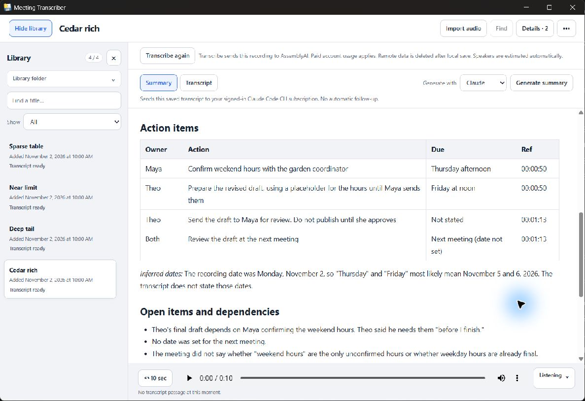
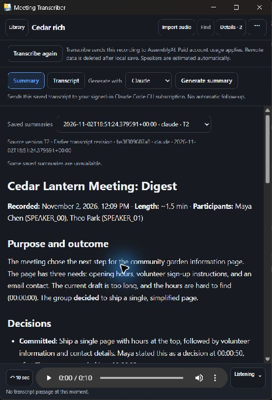
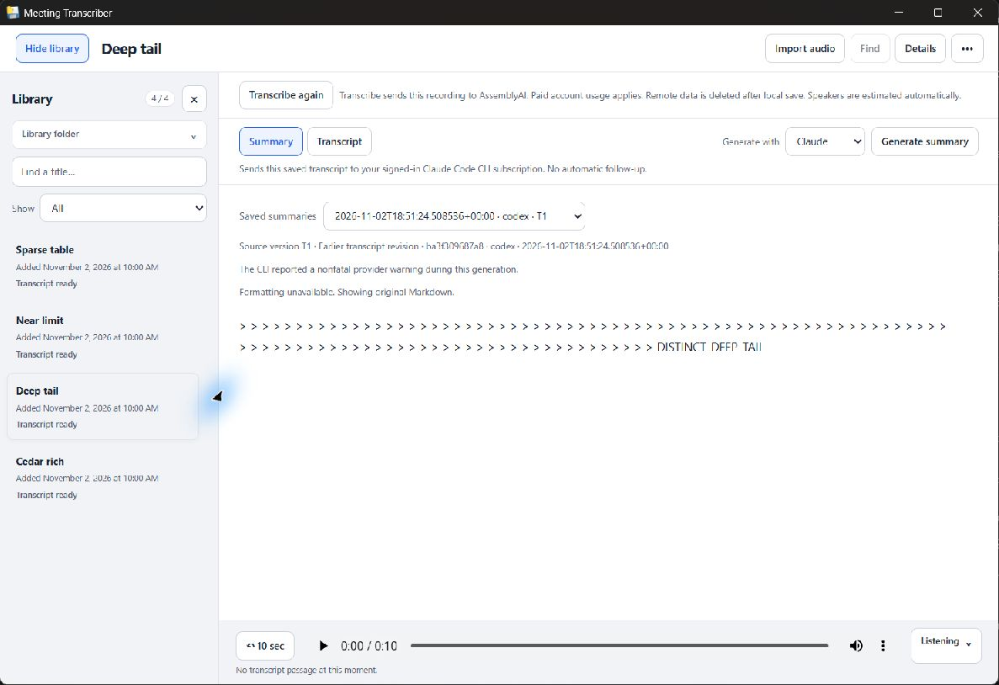
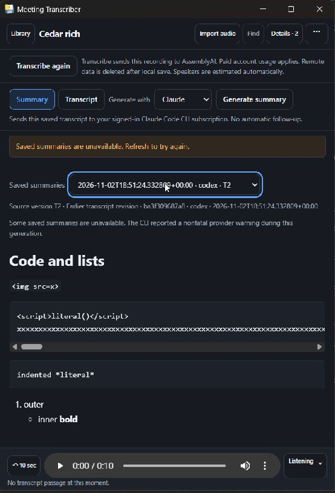
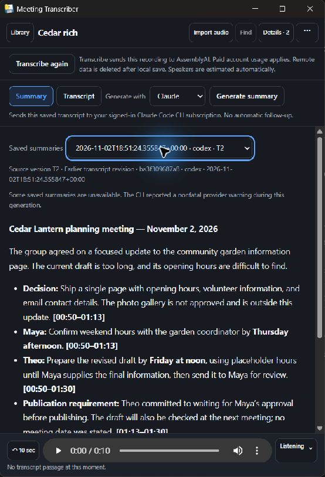

# Windows rendered-summary checkpoint

**Source approved; Windows package checks passed.** Candidate `2dda750389550e553cecd68bd59ec49fa9f37196` is preserved on `codex/rendered-summaries-windows-enb016`, based on `66f9b22e0bf311cd2df8c02f4d802292f7686cec`. Two fresh source reviews approved the same unchanged range with no findings. The final Mac arm64/WKWebView compatibility pass and landing remain pending. This report preserves existing observations; preparing the export made no provider call or new qualification run.

The Summary view now renders headings, lists, emphasis, tables and code locally. Generated links, images and HTML stay inert. A formatting limit or error shows the entire original Markdown with a separate notice. Saved records, provenance and generation behavior are unchanged. [Implementation](https://github.com/ccolosimo3/meeting-transcriber/blob/2dda750389550e553cecd68bd59ec49fa9f37196/desktop/assets/summary-markdown.js), [dependency and bounds](../../../../docs/DEVELOPMENT.md#summary-formatting), [sanitized source reviews](source-reviews.md).

## Candidate and environment

The relocated Windows x64 package contains 105 files. Its executable SHA-256 is `82439f954270344dfe16413086ebdc9f5d9b0c94eab52e865c5b5b932c6e32ec`; its retained package-manifest SHA-256 is `bf2f2eb749c5b049755fd85584d678c30d6e2b6a6e343136bc993389706a02d5`. Python 3.13.15, pywebview 6.2.1 and PyInstaller 6.22.3 used the documented build route. The actual owned WebView2 runtime image was **156.0.4314.58**.

The exact approved markdown-it 15.0.3 browser bundle is 100,786 bytes, SHA-256 `391f2aa638e75e6c7859d0a5c5650ef0956722a45998f17e05b83bc655778e1e`. The combined six upstream notices have SHA-256 `0b2ece9c2df0b3ae40b46d17811bc57caca9c1803200b1dc8cd2cde214dc06c9`. Package, checkout and official distribution bytes matched. Scoped Git attributes preserve those bytes across line-ending settings. No manifest, lockfile, runtime installation or build-tool change was needed.

[Results](results.json) bind the candidate to all 105 package-file hashes, all 33 synthetic-library-file hashes, the original manifest hashes and every exported capture. Hashes identify the tested artifacts; a target-machine rebuild need not produce the same executable hash. No executable, recording, provider receipt or saved-record payload is included here.

## Observed behavior

The library and all home/config locations were synthetic and selected before the first scan. The persistent process image, private session and displayed library were verified before attachment. The two saved fictional summaries were reused from the [earlier live sample](../live-smoke/README.md); no summary was regenerated.

- Wide/light and 554px narrow/dark native views preserve headings, lists, history, provenance and controls. The action table has four readable rows and intact time references. Literal code has its own horizontal scrollbar; surrounding controls stay within the window. Text selection returned the selected name.
- Actual Claude and Codex saved-history selections retain the generic provider warning, unavailable-history warning and earlier-revision label. T2 → T1 → T2 loads each version's own summary.
- A sparse table and 100-level quote take full-source plaintext fallback, keeping the distinctive deep tail and separate provider/formatting notices. Returning to ordinary content restores formatting and clears the formatting notice. The native accessibility tree preserves all source characters with normalized whitespace; the browser test separately checks exact `textContent`.
- Selected native action-to-accessibility outcomes were sparse 242ms, deep 223ms and near-limit 247ms. The near-limit tail remained present without a formatting notice. Separate subsequent transcript/menu input calls returned in 230/220ms. These selected observations are not a universal parser-complexity guarantee.
- Holding aside one synthetic history record produces the existing error notice while retaining the current readable summary. The original file was restored byte for byte. Refresh cleared the transient error and restored the latest rich summary. Summary → Transcript → timestamp selection → Play/Pause → Summary also worked, using approximately seven seconds of silent fixture audio.
- The same exact package reloaded the rich summary, table and saved warnings after restart. Both normal closes released the owned process trees (8 processes, then 7 after restart), listeners and private sessions. All 105 package hashes and all 33 library hashes remained unchanged.

No generated-content navigation, new window or provider action was observed in native use. The served-reader browser cases own the full hostile-input matrix and attempted-request instrumentation; native observations are not a substitute for that instrumentation.

## Verification and limits

The required three-family served-reader browser gate passed in 6.757s: structured/history/completed-result rendering, generated-content request/action inertness, and bounded full-source fallback/recovery. After two CSS-only table-width corrections, only the affected structured family reran, passing in 1.465s each time. The browser's 430px layout case covers forced table/code overflow and no document widening; the native narrow capture is 554px.

The focused Python command ran 21 tests: 12 passed, 8 existing Windows-inapplicable cases skipped, and one unchanged Bridge fixture failed because external FFprobe was absent from PATH. Only that failed case reran with the already-qualified executable override and passed in 1.780s. The initial command was not wholly green. JavaScript syntax checks and full-range whitespace checks passed. Both source reviewers inspected the captures and artifact bindings, verified the official parser/notices and ran narrow independent reader challenges; [their reports](source-reviews.md) retain the scope and residual proof.

Initial Chromium startup and disposable test-oracle problems were corrected without disabling browser safety checks or changing ordinary profiles. Native inspection found tight Owner/Ref cell wrapping; the two small CSS corrections account for existing border-box padding. Earlier preliminary packages and captures are not presented as final proof. The first native sparse oracle used an accessibility field that returned only an embedded-object marker; the corrected oracle used the complete real accessibility tree. No product correction followed that oracle issue.

Mac packaged loading, affected layout/navigation/fallback, saved-byte preservation and cleanup remain for the final Mac compatibility pass. Existing provider, cancellation, native-security and failure-lifecycle evidence was reused where unchanged; it was not broadly replayed. This checkpoint makes no release, signing, installer or whole-delivery claim.

## Original fictional captures

These are inspected, unmodified JPEG bytes from the exact candidate. The retained originals had `.png` filenames; file signatures confirmed JPEG encoding, so this export uses `.jpg` without changing bytes. The code view intentionally retains the unavailable-history notice triggered immediately beforehand; a later Refresh cleared that notice. No image was retouched or reencoded.

