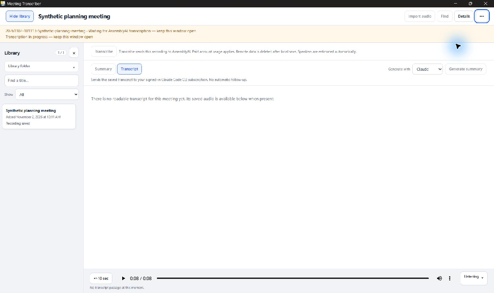
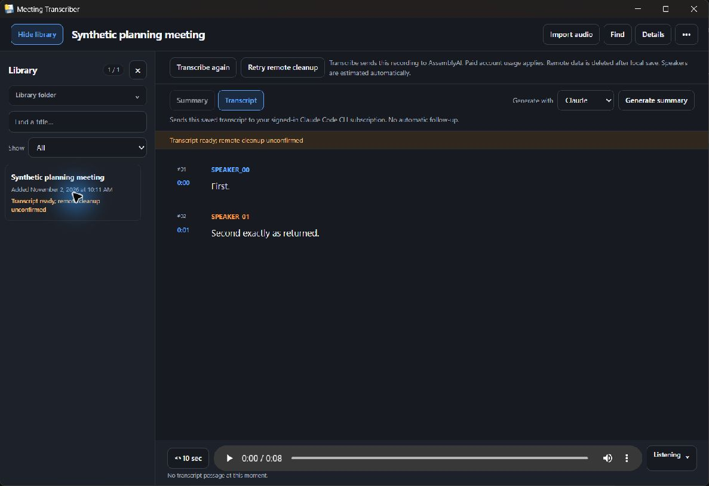
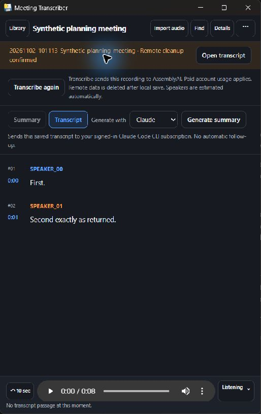
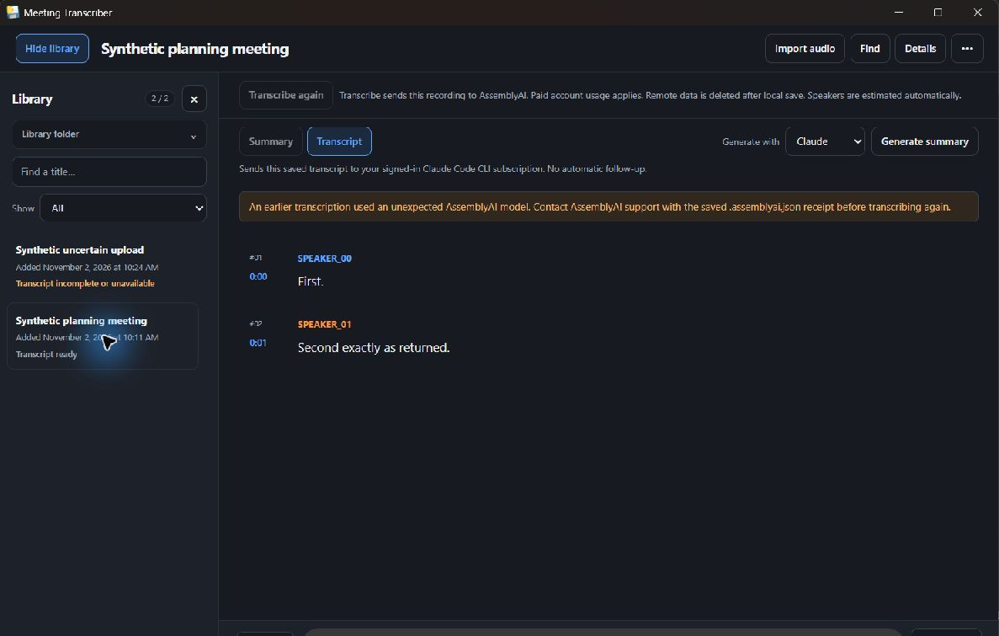
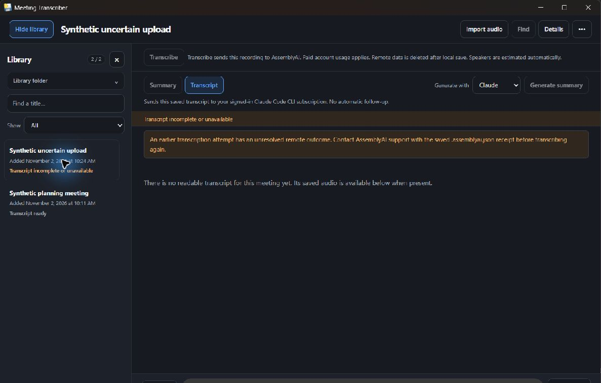

# WIN-QUAL-2 sanitized Windows native evidence

Supplied operator execution result: **PASS** for the relocated native import/transcription workflow. Independent evidence-only assessment is pending with the Mac lead. Product source remains `c390b35a931bac8bfc4e5f0db73e66e1a0e3dccb`/`de3226a`; qualification branch advances are report-only. No production fix, new executable test suite or source-review replay is claimed.

Built at `e3df247c419d9b912596ae77894e152ee04b2df2`; returned at `1dd42c7176038b1f3ff75ed5eeab6006639b3ea4`, with source/config/dependencies unchanged. Windows11 x64; Python3.13.15; uv0.12.5; pywebview6.2.1, Bottle0.13.4, PyInstaller6.22.3; WebView2 156.0.4314.50. Command: task-local uv `run --frozen --python 3.13.15 --extra desktop --group desktop-build python -m desktop.build`, exit0. Relocated102-file package retained all hashes. Exe SHA256 `586a5ab5b917b7c029a853cfef7141e79a238d8e3ae309c2aafd5dacdb3f4a1c`; original manifest SHA256 `8043aa01b12f18b6b9bdf85feaf7cf358ebb88b705dd5027417644459fe44824`. The exported manifest has JSON formatting/newline normalization; entries and relative paths are preserved, not a claim of original file-byte identity.

External FFprobe9.0.2 came from the fixed Gyan essentials ZIP linked by FFmpeg's download route. Actual ZIP matched the published authorized SHA256 `60f467265b1e312373dbcd92200c2618a74850f98d3d078e94296bb3fa2047ba` before extraction/execution; licenses remain with the task-local tool. [Origin/hash metadata](ffprobe-provenance.json). No bundling/global install/PATH/registry/profile changes in this stage.

## Observed scope

Real native import/filepicker, local-only import/refresh/setup, masked fake key Save/readiness/entry clearing, native Locate and actual duration preflight passed. The native audio element reported playing. Explicit first transcription made one upload and one submission; held processing kept starts disabled and native title-bar Close/Alt-F4 were vetoed with a busy warning. No separate Windows File/Quit command exists. No raw bridge duplicate-call injection was attempted.

Changing to a second synthetic library and selecting its prior transcript did not retarget work or steal selection at completion; explicit Open transcript returned the origin. The actual managed-run validator proved four-file publication before forced DELETE403. Transcript/warning survived complete restart; Retry sent exactly one DELETE and cleared warning. A later model mismatch and a separate uncertain-upload500 both blocked retry after another full restart; earlier successful transcript stayed readable and unchanged. All5 source/copied synthetic audio hashes, previous successful/prior run and sibling were preserved. All3 normal app exits removed owned app/WebView process trees, listener and private session. The fixture was also stopped; no owned QA resource remained.

Totals:3 deliberate uploads,2 submissions,460 controlled polls,3 DELETEs, all localhost. No live AssemblyAI/model, real CLI/auth, microphone or summary process. Job Object/summary qualification is a separate boundary.

## Evidence and redaction

- [Results](results.json), [package identity](identity.json), [relative102-file manifest](package-manifest.json), [preservation](final-preservation.json).
- [Provider request metadata](request-metadata.json): methods/relative provider paths/length/auth-presence and pre-delete validity only; no bodies, credentials or desktop capability URLs. Successful publication precedes its DELETE; a known-ID mismatch failure may delete without publishing a new canonical run.
- [Selected launch attestations](launch-attestations.json): synthetic-location, localhost, no-key and system-PATH predicates from recorded launches. Raw environment is excluded. before-normal-close-1/2/3.json and normal-close-1/2/3-results.json retain process/listener/session observations.
- [Source/proof hashes and exact reference transformations](source-proof-hashes.json). Text references [fixture](fixture_server.py.txt) and [launcher](launch_owned.py.txt) are non-executable archives. Their exact transformations normalize only the final CRLF and replace one literal QA-root path with `<QA_ROOT>`. Original ignored artifacts stay unchanged. JSON exports are parsed, selectively redacted and reserialized; their bytes are not raw-artifact identity claims. No personal paths/SIDs or capability URLs are included.

First-run proof/setup issues are retained honestly: missing synthetic Desktop caused a picker location error; created only that owned folder. A broad empty synthetic config directory caused Locate to fail closed; confirmed through production verify_private and recreated only that empty owned directory with private_mkdir. Nested-dialog UIA indices/focus were unavailable, so supported screenshot input and visible focus were used. Initial left-border resize selected text; right-border resize succeeded and selection cleared. No product patch followed these issues.

## Original inspected native captures

At most five target-window JPEGs, original bytes without retouch/reencoding; [hash bindings](capture-hashes.json). Picker captures containing account namespace labels were not retained/exported.

Wide light, processing fixture, Close warning and disabled starts.

Usable transcript and persisted failed-delete warning.

514x814 native window after DELETE-only recovery.

Earlier transcript stays readable, support-before-retry remains.

Unknown upload outcome blocks blind retry.
