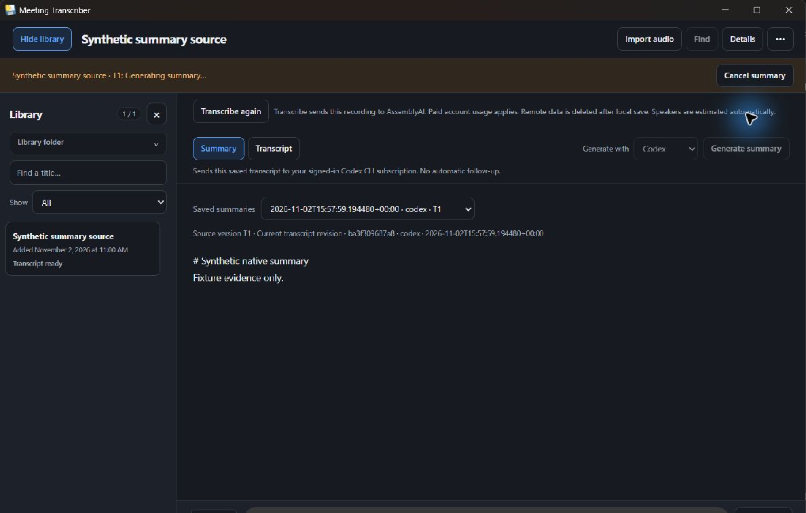
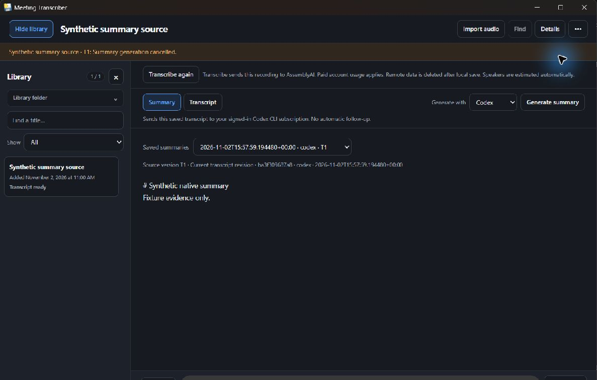

# Corrected Windows summary package qualification

**PASS for the affected native console, Cancel and active-summary normal-close boundary at `2640f2903f4b9e4ebda97697410798bdfaf514a7`.** The original outer reviewer subsequently APPROVED the evidence-only scope at export `3c0e4e0654c6d40930b4d0f1a97e7fe9d403d77f`, with no findings. Source inner and outer gates are also closed. That independent assessment inspected the supplied artifacts on Mac, without executing Windows; this Windows execution report is not self-certification of those gates or full release qualification.

The source delta from `de3226a` is only `desktop/digest_child.py`: import os and apply Windows `CREATE_NO_WINDOW` to the actual provider launch, reusing the existing bootstrap/job/pipe owners. No additional Windows product edit, manifest/lockfile change or shared-ref mutation was needed. Windows owns subsequent platform corrections; the already pushed source fix was reused.

The [pre-fix failure and calibrated gaps at `8c97149`](https://github.com/ccolosimo3/meeting-transcriber/blob/8c97149ffaed3e473b5172bd81043dc6cd32d259/docs/handoffs/windows-2026-11-02/win-qual-3/README.md) remain unchanged. This report closes its console intrusion, native descendant-cancellation attribution and active-summary-close gaps.

## Exact candidate and proof

Windows 11 x64, retained Python 3.13.15/uv 0.12.5, pywebview 6.2.1/Bottle 0.13.4/PyInstaller 6.22.3, WebView2 156.0.4314.50. Build command: absolute task-local uv `run --frozen --python 3.13.15 --extra desktop --group desktop-build python -m desktop.build`, exit 0. Copied the 102-file package into a fresh exclusively owned directory outside the checkout. Exe SHA256 `d5100f870006597c9698a4f92b50fb7b8054a8e7eb71d20cde13a2eba18191db`; original relative manifest SHA256 `686b95151906c2b8165efbb99444b84907f77aef64590cabb321bb8998271918`. All 102 hashes stayed unchanged. Bundled skill equals repo owner, SHA256 `96e5c127b0941d3c3c1c417eb1d06ff4e42a4480f1a5eaadcb8bf4f146c9acb5`. [Identity](identity.json), [manifest](package-manifest.json). JSON export formatting may differ from the original manifest; entries/hashes are preserved.

Fresh synthetic HOME/USERPROFILE/APPDATA/LOCALAPPDATA/CODEX_HOME/CLAUDE_CONFIG_DIR/data/config were set before the first app scan; inherited API keys were cleared. Persistent owned app PID34904/image was verified before UI attach. Only fixed native executable fixtures were discoverable; no real CLI/account/auth/model/API calls. [Launch attestation](launch-attestation.json). Four earlier successful summary records, canonical/media and synthetic configuration sentinels were copied from the previously qualified task-owned synthetic tree and hash-bound before testing.

The proof-only C# fixture retains its console executable subsystem and fixed protocol. Its child/grandchild now wait on the **existing hold mode**, replacing the old 60-second expiry; GetConsoleWindow was added only as OS metadata. The original pre-fix fixture/raw evidence is untouched. [Fixture/reference hashes](source-proof-hashes.json).

- Held native generation remained unobstructed. All 12 metadata/generation CLI invocations and both marker trees reported null GetConsoleWindow; no new WindowsTerminal/OpenConsole process appeared during either held job. The native observations measure visible-console suppression, not absence of all console-related OS processes. [Console observations](console-observations.json), [CLI metadata](fixture-event-metadata.json). Microsoft documents the [CREATE_NO_WINDOW behavior](https://learn.microsoft.com/en-us/windows/win32/procthread/process-creation-flags) and [GetConsoleWindow result](https://learn.microsoft.com/en-us/windows/console/getconsolewindow).
- Native Cancel: one-shot observer held exact Windows handles with matching creation times for provider/child/grandchild. All were live immediately before the action at 16:16:54.129577 UTC; all original handles signaled exit by 16:16:54.358332 UTC (~0.229 s). Hold mode remained unchanged, excluding natural expiry. App showed cancelled, meaning the existing run_process/drain completion path returned. [Observer results](cancel-observer-results.json), [preservation](cancel-preservation-console-results.json).
- Fresh held summary + normal native title-bar Close: all three exact handles were live at 16:20:59.973722 UTC immediately before action; all exited by 16:21:00.167073 UTC (~0.193 s), hold unchanged. App, frozen job/bootstrap, WebView descendants, listener and private session were then gone. [Observer results](close-observer-results.json), [owned runtime snapshot](before-active-close-actual.json), [cleanup](active-close-cleanup-results.json).
- All four prior summaries, canonical/media and synthetic config hashes remained byte-for-byte unchanged. No fifth summary was published by either cancelled job. Library history reload still reads all four. [Preservation hashes](preserved-fixture-hashes.json), [final result](final-preservation-console-results.json). Exact production control argv and stdin hash were observed through the native executable seam for both jobs; metadata/generation share actual captured env/cwd hashes, with all six auth/config locations matching synthetic launch.

## Scope and retained proof corrections

Only two causal held generations ran. Win1 private-file/ACL, Win2 reader/import/transcription, and unaffected Win3 admission/success/headless cases are reused: their owning source/config/dependencies did not change. The coordinator's nine digest tests/bootstrap parity evidence and closed source gates are supplied review facts, not rerun here. No broad test matrix or real provider traffic was added.

A first blanket no-new-conhost assertion failed because that is broader than the visible-window contract; it was narrowed after inspecting actual null console-window handles, native app capture and WindowsTerminal/OpenConsole observations. Raw snapshots remain local; no product patch or test replay followed this proof correction. A covered-window/bounds observation was refreshed before input; no extra job started, and unrelated/occluded imagery was excluded. Marker hold and held-handle pre-action arm remove the earlier cancellation timing gap.

Actual OS Job-assignment rejection was not injected; earlier direct membership/withheld-header proofs remain. The prior launch-PATH transformation origin remains unresolved; this unchanged side question is not claimed solved by the creationflag fix. Actual per-job environment consistency and synthetic auth/config isolation remain verified. Real provider/subscription compatibility, release signing/installers and broader delivery certification are deliberately unselected.

## Evidence integrity

[Results](results.json), ready/armed/observer JSON and [source/proof hashes](source-proof-hashes.json) bind the candidate and observed process identities. Original proof files stay in ignored artifacts. Archived .cs.txt/.py.txt references are non-executable evidence: exact CRLF replacement counts and task-root literal substitutions/hashes are declared. No full prompt, raw env, personal paths/SIDs, keys, auth cache, audio or executable binary is exported. Selected metadata is parsed/redacted/reserialized, with no raw-byte identity claim.

Exactly two original inspected native target-window JPEGs; no retouch/reencoding. [Capture hashes](capture-hashes.json).

