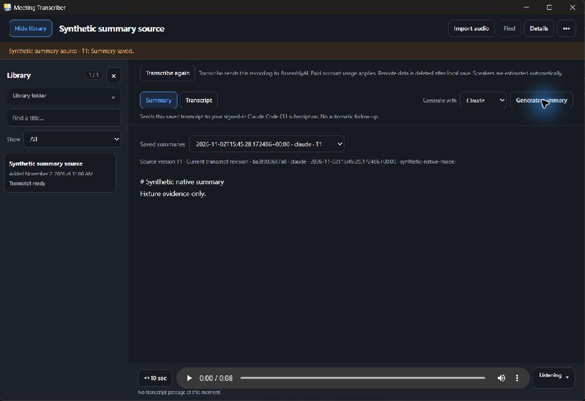

# WIN-QUAL-3 Windows summary evidence — incomplete

**FAIL: unresolved console-window intrusion.** Product source is unchanged at `c390b35a931bac8bfc4e5f0db73e66e1a0e3dccb`/`de3226a`; tested qualification tip was `93a1206fbc5783e9479270708fc53a03dd11a1d6` (report-only commits). No Windows source edit or full digest/Windows certification is claimed. Mac source owner now owns the narrow correction; active-summary native close and native descendant-cancellation causality remain pending.

## Proven boundaries

Actual Windows11 x64 / Python3.13.15 production `Process`/`run_process` proved exact Job membership before trusted header delivery, no provider start before header, close-before-header fail-closed, root/child/grandchild membership and cleanup, cancellation/timeout/root-exited descendants, bounded pipe drains. Real OS handles and creation times were used, no mocked Job API/POSIX substitute/broad taskkill. Actual OS assignment rejection was not forced. [Process results](process-results.json).

Headless Windows production `DigestJob` plus a native executable fixture rejected unavailable auth, missing controls and ignored Codex MCP disables before any transcript payload; Codex success matched production argv, per-server disables and prompt hash, and published through Library. Headless cancel/close held native process handles with matching creation identities and confirmed descendants stopped while keeping previous summaries. These are explicitly headless seam results, not native window-close evidence. [Headless results](headless-job-results.json).

The existing relocated package also exercised frozen `--digest-child` through native Generate for Claude and Codex fixtures, saving/reloading summaries with current canonical-source and bundled-skill hashes. Missing CLI, actual `.cmd`/`.bat` resolver rejection, native per-user executable fallback, native auth/control/MCP refusals, and earlier-summary preservation passed. Native Cancel showed cancelled status and stopped its indefinitely held provider; four saved summary records remained unchanged. [Native Claude metadata](claude-success-results.json), [native Codex metadata](codex-native-results.json), [discovery](discovery-results.json).

The two Claude successes include an extra fixture generation before a metadata-oracle correction; both were retained. One headless Codex success and one native Codex success bring saved history to four. No real provider/subscription/auth/model or AssemblyAI call occurred. The C# executable emits fixed synthetic version/auth/help/MCP/result events. It is not first-party compatibility or account proof. Existing .NET Framework64 csc4.8.9221.0 compiled the x64 console fixture with System.Web.Extensions; no compiler/SDK/global install.

## Unresolved native failure and proof gap

A held console-subsystem fixture opened a blank WindowsTerminal/OpenConsole window over the WebView app. The actual provider launch at `desktop/digest_child.py:17` omits `CREATE_NO_WINDOW`; suppression exists only on the outer bootstrap at `desktop/digest_job.py:108`. OS process observation bound frozen bootstrap28432 to provider14192, with new console hosts32276/29768 created in the same second as that provider. Cancel ended provider/bootstrap and those console hosts. [Failure observation](console-failure.json). The smallest proposed source correction is suppression at the actual Windows provider launch, retaining current job/pipe ownership. No correction was made here. The occluded-console raw screenshot stays local and is excluded from the selected success captures.

**Native child/grandchild cancellation is not proved.** They were alive39seconds after birth, but the post-Cancel observation occurred149seconds after birth; the fixture's60-second child lifetime could have ended naturally during console diagnosis. The initial all-three-killed wording was corrected before this export. [Timing calibration](native-cancel-calibration.json), [before](native-cancel-before.json), [after](native-cancel-after.json). Next corrected-package proof should keep marker descendants in the existing hold mode and check live birth-bound handles immediately before the native action. Native app close during an active summary was intentionally not started after the console failure.

Normal idle shutdown did remove all owned app/WebView processes, listener and private session; the new console hosts were gone. No QA job/process/listener remains. [Before idle close](before-idle-close.json), [cleanup](idle-close-results.json).

## Identity, isolation and metadata

Package exe SHA256 `586a5ab5b917b7c029a853cfef7141e79a238d8e3ae309c2aafd5dacdb3f4a1c`; unchanged WIN2 package. Bundled skill bytes equal the repository owner, SHA256 `96e5c127b0941d3c3c1c417eb1d06ff4e42a4480f1a5eaadcb8bf4f146c9acb5`. Canonical source hash and immutable synthetic Codex/Claude config-sentinel hashes are in [identity](identity.json). All previous records and sentinels were checked unchanged after failure/cancellation.

[Launch attestation](launch-attestation.json) records synthetic HOME/USERPROFILE/APPDATA/LOCALAPPDATA/data/config/**CODEX_HOME/CLAUDE_CONFIG_DIR** before first scan. Actual fixture hashes confirm all six auth/config locations. No real auth cache/config was read. [Selected CLI metadata](fixture-event-metadata.json) retains actual control argv, stdin length/SHA256, cwd hash and selected environment hashes only; no full prompt, raw env, key, capability URL or binary. Within each metadata/generation job chain the complete actual raw env/cwd hashes were identical; that predicate was checked against retained local raw metadata.

Initial verifier assumptions were wrong: app-only data/config variables are intentionally filtered, and native CLI PATH hash differs from initial app-launch PATH. The correct captured-chain invariant and credential/config isolation were verified without changing product policy or replaying generation for bookkeeping. **PATH transformation origin remains unresolved; no launch-PATH equality or unsafe-parent-leak claim is made.** Private session TMP/TEMP/TMPDIR and frozen internal fields are separately observed in [origin diagnostics](environment-origin-diagnostics.json), not assumed leaks. Initial native activation failed after prescribed recovery; the operator then explicitly foregrounded the existing verified PID, permitting native cases to resume without default relaunch.

## Archived references and safe original captures

[Source/proof hashes](source-proof-hashes.json) bind original retained files, tracked references and declared exact transformations: only the final CRLF becomes LF, followed by listed task-root literal replacements with semantic placeholders. Original literal hashes/counts avoid publishing local paths. No raw artifact was rewritten. These `.py.txt`/`.cs.txt` files are non-executable evidence references, not a new test suite/framework. JSON exports are parsed/selectively redacted/reserialized; no raw-byte identity claim. Essential references: [process probe](process_proof.py.txt), [marker tree](marker_tree.py.txt), [native fixture](native_fixture.cs.txt), [launcher](launch_summary.py.txt), [metadata check](native_verification.py.txt), [headless job proof](headless_job_proof.py.txt), [native liveness observer](observe_native_processes.py.txt).

Exactly two original inspected target-window JPEGs, no retouch/reencoding; [capture hashes](capture-hashes.json). Both show only synthetic summary data.

